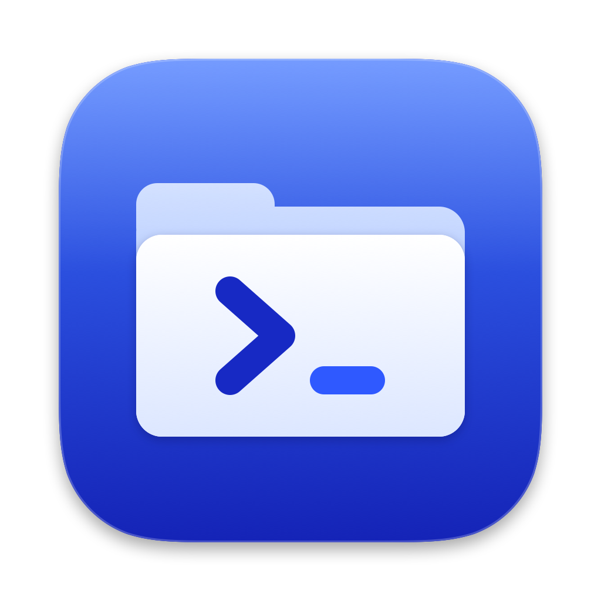
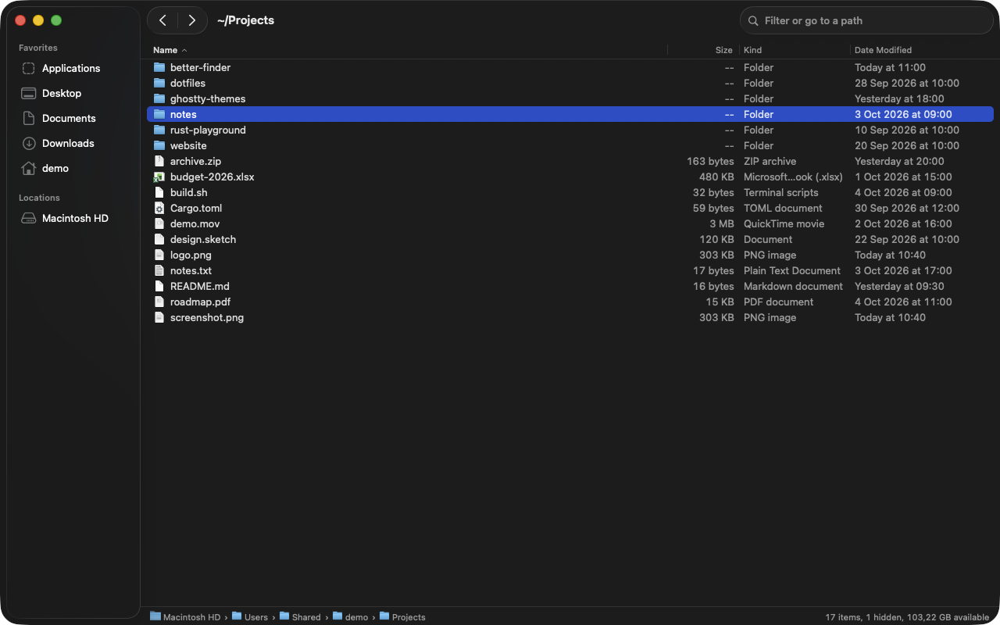
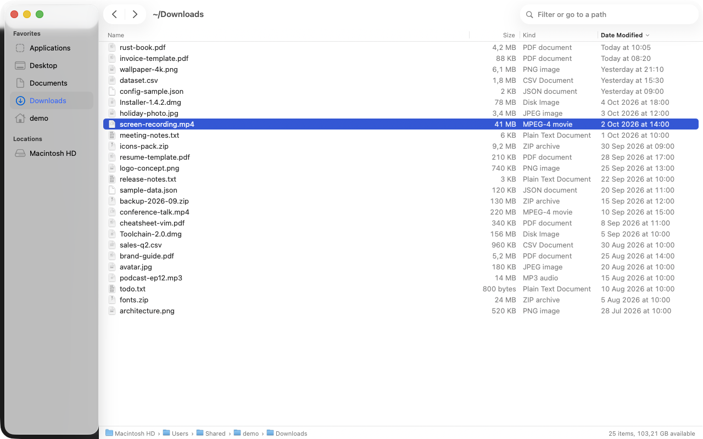
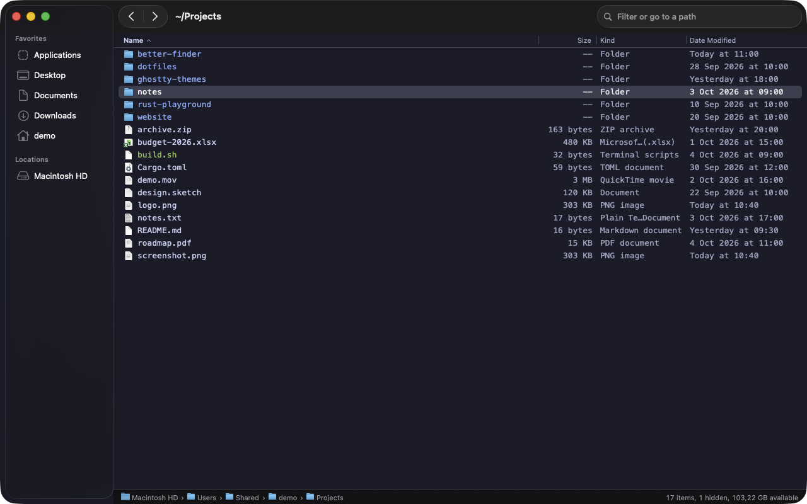
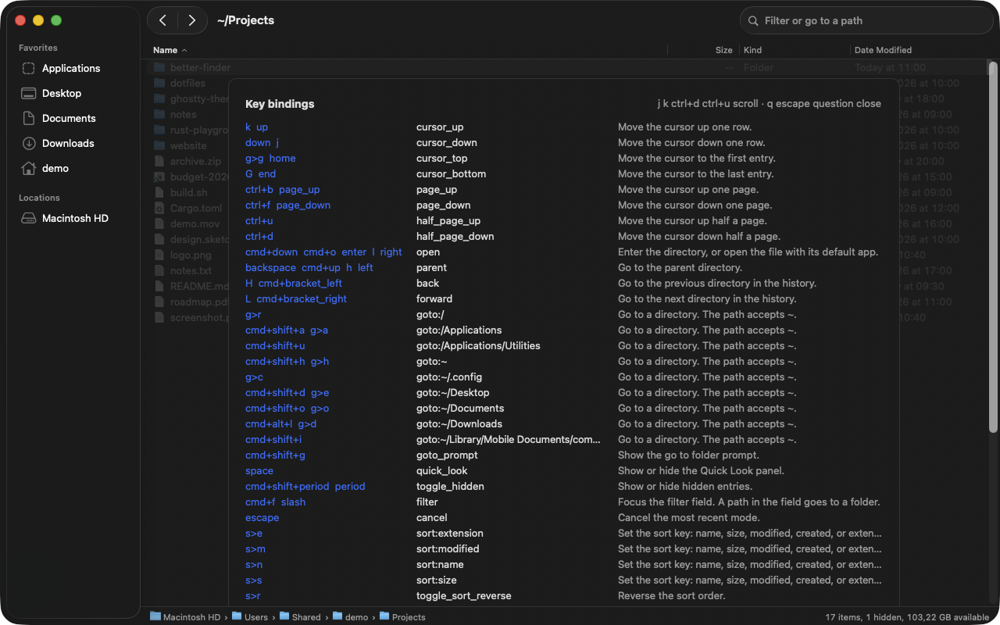
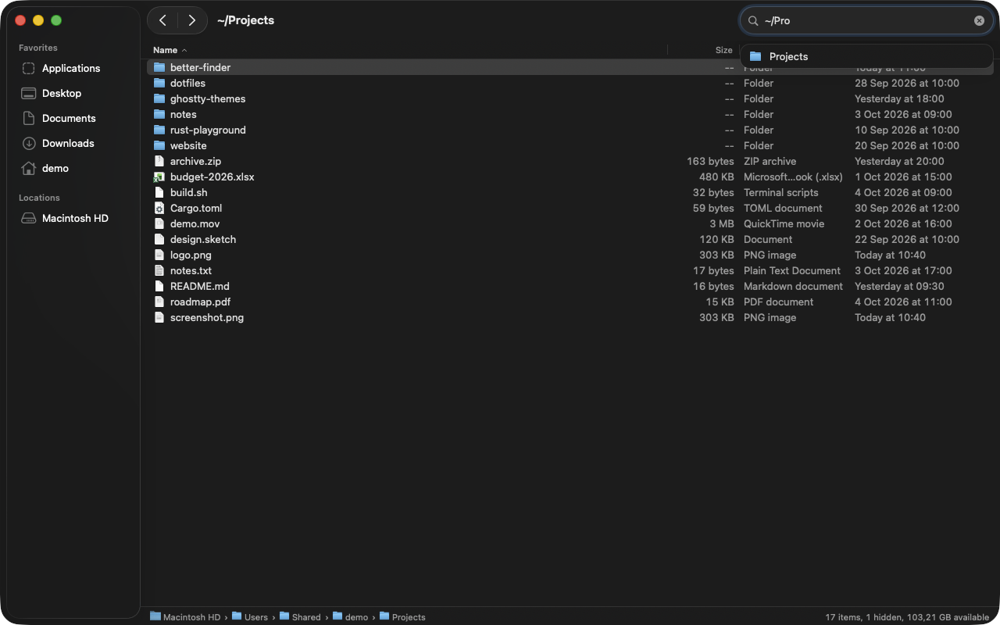

<p align="center">
  
</p>

<h1 align="center">Better Finder</h1>

<p align="center">
  <b>A fast, keyboard-first file explorer for macOS.</b><br>
  Written in Rust. Native AppKit. Configured with one dotfile, like Ghostty.
</p>

<p align="center">
  <a href="https://github.com/p1ratedev/better-finder/actions/workflows/ci.yml"></a>
  
  
  <a href="LICENSE"></a>
</p>

<p align="center">
  
</p>

Finder is good with a mouse. It is slow with a keyboard. Better Finder keeps the good parts of Finder: the native look, Quick Look, the sidebar, and the Trash. Then it adds what power users want: vim keys, an instant response, and a config file that you can keep in your dotfiles.

## Highlights

- ⚡ **Fast.** The window shows in about 150 ms. A folder with 10 000 files loads in about 30 ms, on a background thread. The app uses about 40 to 60 MB of memory.
- ⌨️ **Keyboard first.** vim keys and Finder keys work together. Key sequences such as `gd` (go to Downloads) work. You can bind any key to any of the 35 actions.
- 🧈 **Smooth scroll, like nvim.** `ctrl+d` and `ctrl+u` move the view and the cursor together, with a short animation. `j` and `k` stay instant.
- 📝 **One dotfile.** `~/.config/better-finder/config` uses the Ghostty syntax. The app reloads it when you save it.
- 👀 **Native Quick Look.** Press `Space` to preview a file, like in Finder.
- 🪟 **The Finder look.** A glass sidebar with Favorites and Locations, a toolbar, a column header that sorts, the Kind column, sizes and dates in your locale, and a path bar.
- 💽 **Disks.** Disks, disk images, and network shares show in the sidebar when they mount. `cmd+e` ejects them.
- ✍️ **Your editor.** `Enter` on a text file opens it in nvim (or another editor) in a new Ghostty or Terminal window.
- 🛡️ **Safe file operations.** A rename never replaces a file. A delete moves the file to the Trash. Destructive keys do not repeat when you hold them.

## Install

Better Finder builds from source. You need:

- macOS 13 or later. Development and tests use macOS 26 (Tahoe).
- [Rust](https://rustup.rs) (stable).
- The Xcode Command Line Tools: `xcode-select --install`.

```sh
git clone https://github.com/p1ratedev/better-finder.git
cd better-finder
scripts/bundle.sh --install
```

The script builds a release binary, makes `Better Finder.app`, signs it ad hoc, and copies it to `/Applications`. Spotlight, Raycast, and Launchpad then find it.

To run it from a terminal without an install:

```sh
cargo run --release -p bf-app -- ~/Downloads
```

## A short tour

| Keys | What they do |
| --- | --- |
| `j` `k` | Move down and up |
| `l` or `Enter` | Open a folder or a file |
| `h` or `Backspace` | Go to the parent folder |
| `gg` `G` | Go to the top or the bottom |
| `ctrl+d` `ctrl+u` | Move half a page down or up, with smooth scroll |
| `Space` | Quick Look |
| `/` | Filter the list, or type a path (`~/Pro…`) and go there |
| `Tab` | Move the focus to the sidebar, and back |
| `gd` `gh` `ga` | Go to Downloads, home, or Applications |
| `.` | Show or hide hidden files |
| `r` | Rename in the list |
| `cmd+Backspace` | Move to the Trash |
| `cmd+e` | Eject a disk |
| `?` | Show all keys |

All keys are in [Default keys](#default-keys).

<table>
  <tr>
    <td width="50%"></td>
    <td width="50%"></td>
  </tr>
  <tr>
    <td align="center">Light mode follows macOS</td>
    <td align="center">A custom theme from the config file</td>
  </tr>
  <tr>
    <td width="50%"></td>
    <td width="50%"></td>
  </tr>
  <tr>
    <td align="center"><code>?</code> shows every key</td>
    <td align="center"><code>/</code> filters, or goes to a path</td>
  </tr>
</table>

## Configuration

Better Finder reads one plain text file: `~/.config/better-finder/config` (or `$XDG_CONFIG_HOME/better-finder/config`). The syntax is the Ghostty syntax:

- One `key = value` on each line. A line that starts with `#` is a comment.
- `keybind` can occur many times. A trigger can have modifiers (`cmd+shift+g`) or be a sequence (`g>p`).
- `config-file = ~/dotfiles/better-finder-theme` loads one more file. A `?` before the path makes the file optional.
- The app reloads the file when you save it. Errors show in the status bar, with the line number.

Press `cmd+,` to open the file. When the file does not exist, the app creates it from a template that documents every key.

```ini
# Look: a Catppuccin-style dark theme
theme = dark
background = #1e1e2e
foreground = #cdd6f4
selection-background = #45475a
directory-color = #89b4fa
font-family = "JetBrains Mono"
font-size = 13
background-opacity = 0.97

# Sidebar
sidebar-item = ~/Projects
sidebar-item = ~/Downloads

# List
columns = size,kind,modified
date-format = finder
sort-by = name
directories-first = true

# Behavior
terminal = Ghostty
editor = nvim
smooth-scroll-duration = 150

# Keys
keybind = g>p=goto:~/Projects
keybind = ctrl+n=cursor_down
keybind = ctrl+p=cursor_up
keybind = d=unbind
```

The default theme, `system`, uses the macOS colors and your accent color, like Finder. `theme = dark`, `light`, or `auto` use the custom palette, and every color key changes it.

When `editor` is set, `Enter` opens a text file in that editor, in a new window of the `terminal` app (Ghostty or Terminal). Other files open in their default app. The first time, macOS asks you to allow Better Finder to control the terminal app.

These commands print reference information:

```sh
better-finder +show-config --default   # every key, with its default and help
better-finder +list-keybinds           # the active key bindings
better-finder +list-actions            # every action
better-finder +validate-config         # check the config file for errors
```

## Default keys

| Keys | Action |
| --- | --- |
| `j` `k`, arrows | Move the cursor |
| `l`, `Enter`, `cmd+down` | Open a folder or a file |
| `h`, `Backspace`, `cmd+up` | Go to the parent folder |
| `H` `L`, `cmd+[` `cmd+]` | Back and forward |
| `gg` `G` | Top and bottom |
| `ctrl+d` `ctrl+u` | Half a page down and up (smooth scroll) |
| `ctrl+f` `ctrl+b`, `PageDown` `PageUp` | A page down and up (smooth scroll) |
| `Space` | Quick Look |
| `/`, `cmd+f` | Filter, or go to a path. Text that starts with `~`, contains `/`, or is `..` shows the matching folders. `Tab` completes, `Enter` goes |
| `Tab` | Focus the sidebar. `Tab` again gives the focus back to the list |
| `cmd+ctrl+s` | Show or hide the sidebar |
| `.`, `cmd+shift+.` | Show or hide hidden files |
| `gh` `gd` `ge` `go` `ga` `gc` `gr` | Go to home, Downloads, Desktop, Documents, Applications, `~/.config`, `/` |
| `cmd+shift+h` `cmd+shift+d` `cmd+shift+o` `cmd+alt+l` | Like Finder: go to home, Desktop, Documents, Downloads |
| `cmd+shift+a` `cmd+shift+u` `cmd+shift+i` | Like Finder: go to Applications, Utilities, iCloud Drive |
| `cmd+shift+g` | Go to a folder (a panel with matches) |
| `sn` `ss` `sm` `se` `sr` | Sort by name, size, date, or extension; reverse the order |
| `r` | Rename |
| `cmd+shift+n` | New folder |
| `cmd+Backspace` | Move to the Trash |
| `cmd+e` | Eject a disk. When the disk is in use, press `cmd+e` again within 5 s to force the eject |
| `cc` `cn` | Copy the path or the name |
| `T` | Open a terminal here |
| `?` | Show all key bindings. `q`, `Escape`, or `?` closes the list |
| `cmd+,` `cmd+shift+,` | Open or reload the config file |

## Performance

| Measure | Result |
| --- | --- |
| Launch to the first frame | About 150 to 165 ms (AppKit setup is most of it) |
| Read and sort 10 000 entries | About 30 ms, on a background thread |
| Main-thread work for 10 000 entries | About 1 ms |
| One frame of smooth scroll | 0.3 to 1.2 ms on average |
| Memory (`footprint`) | 41 to 56 MB. Finder used 118 MB on the same Mac. |

The numbers come from one Apple Silicon Mac, with `BETTER_FINDER_TRACE=1` and `footprint`. Finder always runs, because it also draws the desktop. So Better Finder adds to the memory of Finder; it does not replace it.

## How it works

Better Finder follows the Ghostty model: a core library and a thin native shell.

- **`bf-core`** is pure Rust, with no UI code: the config parser, the keymap, the directory listing, sort, filter, navigation state, and the scroll math. 146 unit tests cover it.
- **`bf-app`** is the native macOS app, written with AppKit through [`objc2`](https://github.com/madsmtm/objc2):
  - A custom list view draws only the visible rows, so a frame costs the same for 50 files or 100 000.
  - `Space` opens the real `QLPreviewPanel`.
  - The sidebar is a native split view, so it gets the glass look of macOS 26.
  - The app has its own FSEvents streams, which refresh the folder when it changes on disk.

The design contracts are in [`docs/ARCHITECTURE.md`](docs/ARCHITECTURE.md) and [`docs/UI.md`](docs/UI.md).

## Roadmap

- [ ] Multi-select, and copy, cut, and paste of files
- [ ] Drag and drop to and from other apps
- [ ] Tabs and split panes
- [ ] A column view (Miller columns) with a preview column
- [ ] Date groups (Today, Yesterday, Previous 7 Days) and a Date Added column
- [ ] Image thumbnails as icons
- [ ] Tags in the sidebar
- [ ] Theme files (`theme = catppuccin`), like Ghostty
- [ ] Key bindings for keyboard layouts that are not Latin
- [ ] Accessibility (VoiceOver)
- [ ] Signed releases and a Homebrew cask

## Contributing

Issues and pull requests are welcome. [`CONTRIBUTING.md`](CONTRIBUTING.md) tells you how to build, how to test the UI without a mouse, and which rules the code follows.

## License

MIT. See [`LICENSE`](LICENSE).

## Thanks

- [Ghostty](https://ghostty.org), for the idea of one plain config file with live reload.
- [`objc2`](https://github.com/madsmtm/objc2), which makes AppKit usable from Rust.
- Finder, for the parts that we kept.

Better Finder is not affiliated with Apple. Finder, macOS, and Quick Look are trademarks of Apple Inc.
